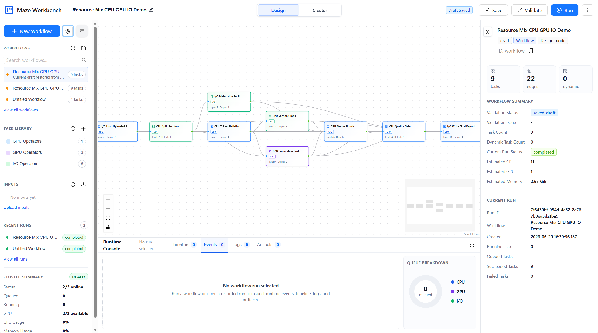
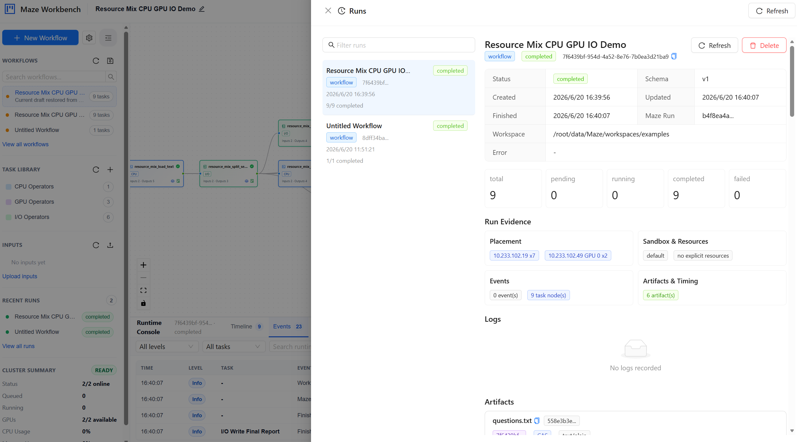
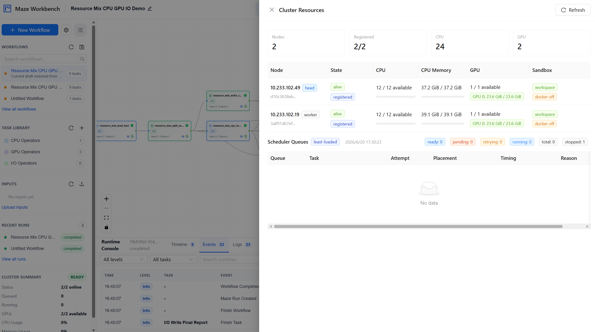

<h2 align="center"> Maze: A Distributed Framework for LLM Agents</h2>

<p align="center">
    <a href="https://mazeagent.net/">
        
    </a>
    <a href="https://maze-doc-new.readthedocs.io/en/latest/">
        
    </a>
</p>

Maze turns agent programs into distributed, observable workflows. It schedules task-level work across heterogeneous resources while keeping execution, recovery, model serving, and artifacts behind one runtime API.

## Highlights

- **Visual workflow development.** Maze Workbench combines a DAG editor, reusable task and workflow catalogs, server-side workspaces, files, validation, execution, Run inspection, and cluster operations.
- **Heterogeneous scheduling.** Independent `gpu`, `cpu`, and `io` queues prevent one resource class from blocking another. Maze supports `FCFS` and the paper-aligned `HACS` scheduling algorithm.
- **Static and dynamic workflows.** Define DAGs with `@workflow`, submit portable `maze.workflow/v1` specifications, or append tasks at runtime with persisted `DynamicRun` state.
- **Distributed model execution.** Maze discovers local checkpoints, deploys reusable vLLM or Transformers instances on demand, routes model tasks, and manages GPU reservations and scale-in/out.
- **Durable operations.** Runs retain task state, structured errors, events, logs, retries, timeouts, cancellation, placement, and content-addressed artifacts across process restarts.
- **One execution surface.** The Python SDK, LangGraph adapter, Workbench, and application specifications use the same Maze Core Run and observability APIs.

## Architecture

```text
Python SDK / LangGraph / Workbench / App Spec
                     |
             maze.workflow/v1
             POST /workflows/submit
                     |
                 Maze Core
          Runs, events, logs, artifacts
                     |
              Scheduler + Ray
       gpu / cpu / io queues + model wait
                     |
             Head and worker nodes
```

- **Core owns Runs.** A Core `run_id` is the public run identity. Static workflows, DynamicRuns, and application specs share persisted snapshots, events, logs, artifacts, cancel, and retry APIs.
- **Clients submit DAGs.** SDK, LangGraph, and Workbench workflows converge on the same `maze.workflow/v1` contract instead of maintaining separate execution paths.
- **Workspaces own editable inputs.** A server-side workspace contains user workflows, task definitions, and files. Runs remain Core-owned and retain their workspace context.
- **Scheduling and placement are separate.** `FCFS` or `HACS` orders ready tasks; the node placement strategy selects a registered node with suitable resources.
- **Model wait is explicit.** A task waiting for a local model instance is not counted as a dispatchable GPU, CPU, or I/O queue item. It returns to its resource queue after routing becomes available.
- **Ray provides distributed execution.** Maze adds workflow contracts, resource semantics, durable state, scheduling, model lifecycle, artifacts, and operational APIs above Ray.

## News

- **2026-08**: Maze consolidated SDK, LangGraph, and Workbench DAG execution around Core-owned Runs and the `maze.workflow/v1` contract. Workbench added switchable server-side workspaces, workflow and file management, concurrent submission and cross-workspace Run inspection, and four GAIA workflow templates. Scheduler-managed local model execution was validated with both vLLM and Transformers, including automatic deployment, explicit model-wait state, cancellation, and deterministic GPU cleanup.
- **2026-07**: Maze introduced paper-aligned heterogeneous `gpu/cpu/io` queues, pluggable `FCFS` and `HACS` scheduling, observed-runtime estimates, richer queue diagnostics, and warm standby workers. Distributed execution was hardened with worker re-registration, run-level deadlines, explicit scheduler-failure states, and restart-safe Run discovery. The Maze research paper was accepted to SC26.
- **2026-06**: Maze added unified Run operations, content-addressed artifacts, local model routing, cluster management, and runtime fault-tolerance traces.
- **2026-05**: Maze added persisted DynamicRuns, workspace file execution, and the Workbench `Runs` and `Cluster` views.

## Quick Start

### Install

From PyPI:

```bash
pip install maze-agent
```

From source:

```bash
git clone https://github.com/maze-agent/Maze.git
cd Maze
pip install -e .
```

### Start Maze and Workbench

```bash
maze start --head --port 8000 --playground --detach
```

- Workbench: `http://localhost:5173`
- Core API: `http://localhost:8000`

Manage the detached service with:

```bash
maze status
maze doctor
maze stop
```

Maze validates its configured ports before startup and prints the detached log path. Use `--playground-port` to change the UI port. The Workbench backend uses port `3001` by default, or `--playground-port + 1` when the UI port changes; `--playground-backend-port` overrides it explicitly.

### Add Workers

Start a worker that periodically re-registers after Head or Ray restarts:

```bash
maze start --worker \
  --addr HEAD_IP:8000 \
  --agent \
  --heartbeat-interval 20
```

Stop a local worker with `maze stop --worker`. A Ray node must also register as a Maze worker before Maze can schedule tasks to it.

Inspect the cluster with:

```bash
maze cluster resources --server-url http://HEAD_IP:8000
maze cluster queues --server-url http://HEAD_IP:8000
maze cluster join-command --server-url http://HEAD_IP:8000
maze cluster reconcile-workers --server-url http://HEAD_IP:8000
```

### Scheduling Options

`FCFS` is the default task ordering. Enable HACS independently of node placement:

```bash
maze start --head \
  --port 8000 \
  --strategy least-loaded \
  --scheduling-algorithm HACS
```

HACS refreshes ready-task priorities at dispatch time and uses completed workflow durations to maintain its DCT EMA.

| Environment variable | Default | Constraint |
| --- | ---: | --- |
| `MAZE_HACS_ALPHA` | `2` | greater than 0 |
| `MAZE_HACS_BETA` | `5` | greater than 1 |
| `MAZE_HACS_INITIAL_DCT_SECONDS` | `60` | greater than 0 |
| `MAZE_HACS_DCT_EMA_ALPHA` | `0.2` | greater than 0 and at most 1 |
| `MAZE_HACS_STARVATION_SECONDS` | `600` | greater than 0 |

Warm standby workers are enabled by default. Disable standby creation and execution together with:

```bash
MAZE_STANDBY_WORKERS_ENABLED=0 maze start --head --port 8000
```

## Workflows

### Static Workflow

```python
from maze import MaClient, task, workflow


@task(resources={"cpu_num": 1, "gpu_mem": 0, "io_num": 0})
def greet(text: str):
    return {"result": f"Hello {text}"}


@task(resources={"cpu_num": 1, "gpu_mem": 0, "io_num": 0})
def uppercase(result: str):
    return {"upper": result.upper()}


@workflow
def hello(name: str):
    greeting = greet(name)
    return uppercase(greeting.result)


client = MaClient("http://localhost:8000")
workflow_run = client.create_workflow_from(hello, inputs={"name": "Maze"})
run_id = workflow_run.run()
run = client.wait_run(run_id)
print(run["result_summary"])
```

`@workflow` builds a DAG without executing task functions locally. Visual and external DAG builders can submit the same contract with `MaClient.submit_workflow(spec)`.

### Dynamic Workflow

```python
from maze import MaClient, task


@task(resources={"cpu_num": 1, "gpu_mem": 0, "io_num": 0})
def summarize(topic: str = ""):
    return {"summary": f"Maze can build workflows dynamically for {topic}."}


client = MaClient("http://localhost:8000")
run = client.create_dynamic_run(max_tasks=10)
summary = run.append_task(summarize, inputs={"topic": "agent runtime"})
run.wait_for_task(summary)
run.finalize({"status": "done"})
print(run.status())
```

### Application Spec

Application-style jobs can be submitted from `maze.yaml`:

```yaml
name: gpu-demo
command: python train.py
workspace: .
resources:
  cpu_num: 4
  gpu_mem: 8192
  io_num: 0
env:
  conda: maze
  vars:
    DATASET: sample
artifacts:
  - outputs/
timeout_seconds: 1800
retries:
  max: 1
  backoff_seconds: 5
  on: [node_lost, resource_unavailable]
```

```bash
maze app validate maze.yaml
maze run maze.yaml --wait
maze runs logs <run_id>
maze runs retry <run_id>
```

Each app execution is recorded in the unified Run history with lifecycle events, placement, logs, and artifacts.

## Files and Artifacts

Workbench files live under the active server-side workspace. During execution, Maze stages them into each task sandbox, so task code should use relative paths such as `Path("input.csv")` or `Path("folder/data.json")`, not hard-coded `workspace/files/...` paths.

For distributed runs without shared storage, enable the Head content-addressed artifact store:

```python
run_id = workflow_run.run(
    workspace_dir="/tmp/my_workspace",
    artifact_mode=True,
)
```

Workers download required inputs and upload changed outputs. Run manifests use stable references such as `maze://artifacts/sha256/<hash>` instead of worker-local paths.

## Model Execution

Model-routed tasks declare a `modelAnchor` in a Workbench node or `model_anchor` in a `maze.workflow/v1` task:

Maze discovers checkpoints in `<repository>/model_cache` by default; configure another existing directory in Workbench settings or with `MAZE_MODEL_DIR`.

```json
{
  "task_kind": "gpu",
  "resources": {"cpu_num": 1, "gpu_mem": 8192, "io_num": 0},
  "model_anchor": {
    "local_model": "Qwen2.5-3B-Instruct",
    "model_scope": "head",
    "backend": "transformers",
    "estimated_gpu_mem_mb": 8192
  }
}
```

- Nodes report their locally available checkpoints and supported `vllm` or `transformers` runtimes.
- If a matching checkpoint exists but no instance is ready, Maze deploys one through the scheduler and keeps the task in `Model Wait`.
- Model-waiting tasks do not occupy a GPU dispatch queue. They return to the resource queue after a route becomes available.
- `missing_model` means no eligible node reported the requested local checkpoint. It is distinct from a checkpoint that exists but has not yet been deployed.
- Workflows consume the injected OpenAI-compatible endpoint and model route; they do not start or stop model processes themselves.
- Scheduler-managed instances reuse GPU leases, support progressive scale-out, and release idle instances through LRU scale-in.

GPU tasks also learn memory demand from execution observations and can recover
from CUDA OOM through verified cleanup and resource re-anchoring. Managed model
services recover at the instance layer. See [resource adaptation and validation](docs/resource_adaptation.md)
for memory limits, ownership, retry behavior and tests.

The system catalog includes GAIA `reason`, `file`, `speech`, and `vision` as ordinary workflows. Text and vision paths use standard chat interfaces; speech uses a standard transcription interface and requires an available transcription checkpoint. These templates exercise Maze workflow integration and are not a claim of reproduced GAIA benchmark accuracy.

## Run Operations

Static workflows, DynamicRuns, and app runs share the same operational surface. Run snapshots include lifecycle state, timing, progress, result or error summaries, task state, placement, and artifacts. Task failures use structured fields such as `error_type`, `message`, `retryable`, `origin`, `node_id`, `node_ip`, `attempt`, and `traceback`.

Configure task reliability on the decorator:

```python
@task(
    resources={"cpu_num": 2, "gpu_mem": 8192, "io_num": 0},
    timeout_seconds=300,
    max_retries=2,
    retry_backoff_seconds=5,
    retry_on=["node_lost", "artifact_error"],
)
def train_one_shard(shard: str):
    return {"status": f"finished {shard}"}
```

Query and operate on Runs after submission:

```python
client = MaClient("http://localhost:8000")

runs = client.list_runs(limit=20)
run = client.get_run(run_id)
tasks = client.get_run_tasks(run_id)
events = client.get_run_events(run_id, after=None)
artifacts = client.get_run_artifacts(run_id)
logs = client.get_run_logs(run_id, tail=200)

client.cancel_run(run_id, reason="no longer needed")
client.retry_run(run_id, workspace_dir="/tmp/my_workspace")
```

The same controls are available from the CLI:

```bash
maze runs list --server-url http://HEAD_IP:8000
maze runs show <run_id> --server-url http://HEAD_IP:8000
maze runs events <run_id> --server-url http://HEAD_IP:8000
maze runs logs <run_id> --tail 200 --server-url http://HEAD_IP:8000
maze runs retry <run_id> --server-url http://HEAD_IP:8000
maze artifacts list <run_id> --server-url http://HEAD_IP:8000
```

Core exposes the corresponding `/runs`, `/runs/{run_id}`, `/runs/{run_id}/tasks`, `/runs/{run_id}/events`, `/runs/{run_id}/logs`, `/runs/{run_id}/artifacts`, cancel, and retry endpoints.

## Maze Workbench

In **Runs**, select a run and choose **Open in canvas** to inspect its execution
in the full Workbench layout. The run list is on the left, the live DAG is in
the center, and selecting a node opens its results, resources, logs and artifacts
in the right inspector. Both side panels can collapse. **Design** returns to the
current workflow draft; **Run** restores the execution view. Direct links use
`?run_id=<RUN_ID>&view=canvas` and restore that view after a refresh.

Start Workbench together with the Head:

```bash
maze start --head --port 8000 --playground
```

A server-side workspace provides editable workflows, reusable Python task definitions, uploaded inputs, and downloadable outputs. Workspaces can be created and switched from the left sidebar. Loading a system workflow imports only its referenced task definitions and sample files into the active workspace; system templates remain separate from user-owned files.

The `Runs` console keeps active and completed Runs inspectable after submission, including task state, structured errors, placement, events, logs, cancellation, retry, and artifacts. The `Cluster` view shows registered Head and worker nodes, CPU and GPU availability, per-device memory, model wait, resource queues, retry delays, and placement rejection reasons.

### Workflow Design



### Run Inspection



### Cluster Resources



For detailed usage, see the [Maze documentation](https://maze-doc-new.readthedocs.io/en/latest/).

## Citation

Please cite our work if you find the project useful:

```bibtex
@inproceedings{gu2026maze,
  title     = {Maze: A Distributed Framework for Large Language Model Agents},
  author    = {Jing Gu and Zhuang Xing and Yiheng Yang and Bowen Lv and Jiale Wang and Shuo Yuan and Zijin Chen and Jin Zhao and Pengfei Zuo and Long Zheng and Xiaofei Liao and Hai Jin and Qinbin Li},
  booktitle = {Proceedings of the International Conference for High Performance Computing, Networking, Storage and Analysis},
  year      = {2026}
}
```

## Acknowledgement

We thank contributors from Huazhong University of Science and Technology, Huawei, and other institutions for their support and contributions to this project.
