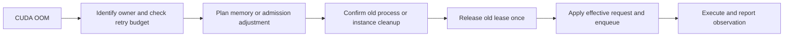

# GPU resource adaptation and OOM recovery

Maze applies one memory policy to static tasks, dynamic tasks and model deployment.
It keeps the submitted resource declaration, effective request and measured usage
separate. A declaration acts as a minimum; a matching observation can raise it.

## Task resources

```python
from maze import task

@task(
    task_kind="gpu",
    resources={"cpu_num": 1, "gpu_mem": 4096, "gpu_mem_limit": 16000},
    max_retries=1,
)
def infer(text: str):
    # Execute a GPU operation and return a dictionary.
    return {"answer": text}
```

`gpu_mem` and the optional positive `gpu_mem_limit` are in MiB. Observations and
failed allocation sizes use bytes internally. If the policy needs more than the
configured limit, it reports the reason instead of truncating its estimate.

The policy considers the declared minimum, checkpoint weight estimate, matching
successful observations with 15% headroom, and previous OOM demand lower bounds.
For a CUDA OOM it includes the allocation that failed, when the backend reports
it, and uses bounded fallback growth (25% or 256 MiB). An OOM observation is not
treated as a successful peak measurement. Execution retries remain governed by
`max_retries`, `retry_on` and workflow deadlines.

## History and resource ownership

Core owns the resource history file in the configured workspace. The scheduler
sends observations through its existing event channel. Profiles separate code
or checkpoint identity, backend, dtype, memory ownership and known input-size
buckets. Input features contain size information rather than prompt text.
Model load measurements provide a baseline; inference failures for a known input
bucket affect that bucket rather than every request to the model.

Direct tasks report PyTorch allocator peaks. Model instances sample their own
process group's memory through NVML after warmup. If that measurement is
unavailable, it remains unknown. The HTTP caller's allocator usage cannot train
the model instance profile.

History schema 3 retains older aggregates for diagnostics, but older unscoped
records do not drive new predictions. Recent observations, profiles and
persisted deduplication IDs are bounded (100 observations, 1024 profiles and
8192 IDs). Core also rejects stale attempt events. Corrupt history is surfaced
instead of being silently replaced.

## Recovery lifecycle



For a direct GPU task, recovery verifies the old worker's PID, process start
identity and node before releasing its lease. Cleanup runs outside the scheduler
lock. If cleanup cannot be confirmed, the GPU lease remains reserved and the
workflow reports `resource_cleanup_failed`.

A task routed to a managed model service owns a CPU caller lease; the model's GPU
lease belongs to the instance. A model OOM is handled at the instance layer:

- Concurrent in-flight requests are allowed to finish. Admission for that model
  is reduced to one request per instance for the Head's remaining lifetime.
- An idle failing instance is stopped through the existing verified lifecycle,
  then demand is redeployed with a higher reservation. Idle instances with too
  small a reservation can be reclaimed for pending demand.
- A model load OOM can retry once after startup cleanup is confirmed. It uses
  the same resource policy and respects memory limits.
- Route generation checks prevent an old response from stopping a replacement
  instance. Cancelling a request removes its reservation contribution from
  pending model demand.

The bundled inference client preserves OOM details from an error response and
identifies managed instances through the injected route. Custom clients should
raise `ModelInferenceError` with structured memory facts, or return Maze's error
envelope. External services retain external ownership and are not redeployed by
Maze.

Demand above the known capacity of every eligible device fails with
`resource_capacity_exceeded`. A busy device that could fit the request remains a
resource wait, bounded by the configured workflow deadline. Older workers without
physical-capacity information remain unknown rather than being treated as zero
capacity.

GPU memory declarations influence placement and reservations; they do not impose
a CUDA allocator quota. Recovery keeps the requested model precision and request
contents. It cannot create additional physical memory on a single GPU.

## Validation

Run the deterministic suite:

```bash
conda activate maze
python -m pytest -q tests/test_resource_adaptation.py
```

Start a local GPU Head and opt into the integration suite:

```bash
maze start --head --detach
MAZE_GPU_CORE_URL=http://127.0.0.1:8000 \
MAZE_GPU_MODEL_DIR=/root/data/Models/Qwen3-8B \
python -m pytest -q tests/test_resource_adaptation_gpu.py
maze stop
```

The CUDA tests use a small per-process allocator limit to produce a real OOM,
verify successful retry and learned demand, verify retry exhaustion, and reject
an impossible demand. The model test injects a structured service OOM into a real
Qwen instance, verifies replacement and a real chat response, then stops the
replacement. It is a recovery fault-injection test, not a model load stress test.

Single-GPU validation does not establish migration or throughput on a multi-node
cluster. Device selection is also covered with deterministic capacity snapshots.
